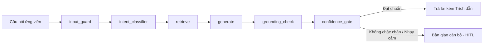

# EDU-12 — Trợ lý tuyển sinh X (Admission X AI)

> **Trợ lý tuyển sinh AI tư vấn 24/7 và tăng gắn kết ứng viên**  
> Dự án giải quyết bài toán quá tải tư vấn tuyển sinh tại Trường Đại học X, đảm bảo phản hồi tức thì, chính xác dựa trên nguồn chính thống và tự động bàn giao các câu hỏi ngoài phạm vi cho cán bộ chuyên trách (Human-in-the-Loop).

---

## 1. Bối cảnh & Thực trạng

Phòng tuyển sinh Trường Đại học X thường xuyên đối mặt với:
- **Khối lượng câu hỏi lặp khổng lồ** về quy chế tuyển sinh, ngành đào tạo, phương thức xét tuyển, học phí và học bổng qua nhiều kênh liên lạc (Website, Fanpage, Hotline, Email).
- **Cán bộ tư vấn quá tải** trong các giai đoạn cao điểm, dẫn đến thời gian phản hồi kéo dài.
- **Ứng viên chờ đợi lâu**, dễ nản lòng và bỏ cuộc trước khi hoàn tất hồ sơ xét tuyển.

---

## 2. Mục tiêu & Chỉ số nghiệm thu (KPIs)

Dự án phát triển hệ thống chatbot tuyển sinh thông minh hoạt động 24/7, định hướng và dẫn dắt quy trình nộp hồ sơ, cá nhân hóa theo nguyện vọng của ứng viên nhằm gia tăng tỷ lệ gắn kết (*Applicant Engagement*).

### Chỉ số nghiệm thu mục tiêu:
| Chỉ số | Mục tiêu | Ý nghĩa |
| :--- | :---: | :--- |
| **Answer Rate** | **≥ 70%** | Tỷ lệ câu hỏi hợp lệ được trợ lý AI giải đáp hữu ích (không cần chuyển người). |
| **Accuracy** | **≥ 85%** | Độ chính xác của các câu trả lời do AI cung cấp (được xác thực trên tập test có nhãn). |
| **Giảm tải cán bộ** | **≥ 50%** | Tỷ lệ giảm câu hỏi cần cán bộ tuyển sinh phải trực tiếp trả lời so với cùng kỳ. |

> *Lưu ý: Các chỉ số trên là mục tiêu nghiệm thu của đề bài, được đánh giá định lượng thông qua pipeline kiểm thử tự động.*

---

## 3. Nguyên tắc & Ràng buộc an toàn

1. **Chính xác & Dẫn nguồn chính thống (Grounding First)**: Toàn bộ câu trả lời về chính sách, điều kiện, học phí và học bổng phải dựa trên đề án và văn bản tuyển sinh chính thức, luôn đi kèm trích dẫn nguồn (*official citation*).
2. **Tuyệt đối không bịa đặt (Zero Hallucination)**: Không suy đoán điểm chuẩn các năm chưa công bố, không tự đưa ra hạn nộp hoặc học phí chưa ban hành, và không cam kết kết quả trúng tuyển.
3. **Bàn giao người liền mạch (HITL Handover)**: Tự động chuyển giao sang hàng chờ của cán bộ khi câu hỏi ngoài phạm vi, chứa nội dung nhạy cảm hoặc độ tin cậy truy xuất không đạt ngưỡng an toàn.
4. **Bảo mật & Tối thiểu hóa dữ liệu (Minimal PII)**: Chỉ thu thập dữ liệu cá nhân cần thiết phục vụ tư vấn; tuân thủ quy định bảo mật thông tin thí sinh.
5. **Kiểm soát chi phí & Hiệu năng**: Tối ưu độ trễ (P95 latency), áp dụng caching cho các câu hỏi thường gặp (FAQ) nhằm đáp ứng lưu lượng truy cập lớn trong mùa tuyển sinh cao điểm.

---

## 4. Kiến trúc hệ thống (Monorepo Architecture)

Dự án được cấu trúc theo mô hình monorepo, phân tách rành mạch giữa giao diện, dịch vụ API, luồng điều phối AI và bộ kiểm chuẩn độc lập:

```text
admission-x-ai/
├── apps/
│   ├── web/            # Next.js 15 (React 19) — Giao diện ứng viên (/chat) & Cán bộ (/staff/handovers)
│   └── api/            # FastAPI (Python 3.11) — Backend modular monolith:
│       ├── app/
│       │   ├── api/routes/   # REST API endpoints (/chat, /handovers, /metrics, /conversations)
│       │   ├── core/         # Cấu hình hệ thống (Settings, CORS)
│       │   ├── db/           # Kết nối cơ sở dữ liệu Supabase
│       │   ├── schemas/      # Pydantic schemas dữ liệu vào/ra
│       │   └── ai/           # Module AI nội bộ (LangGraph, Agents, RAG, Guardrails, Memory, Prompts)
│       └── tests/            # Kiểm thử backend API và AI integration
├── evals/              # Bộ dữ liệu mẫu vàng (Golden Datasets), LLM-as-Judge & Agent-Harness tests
├── workers/            # Ingestion worker (nạp tài liệu), Evaluation & Nurture workers
├── supabase/           # Migrations & cấu hình cơ sở dữ liệu Supabase pgvector
├── docs/               # Tài liệu chi tiết: Đề bài (EDU-12), kiến trúc, agent-harness, evaluation
└── infra/              # Docker Compose, deployment & monitoring scripts
```

---

## 5. Luồng xử lý AI (AI Graph Pipeline)

Hệ thống ứng dụng **LangGraph** để kiểm soát tuần tự các trạng thái và rào chắn an toàn:



- **`input_guard`**: Phát hiện nội dung độc hại, lừa đảo hoặc vi phạm chuẩn mực.
- **`intent_classifier`**: Nhận diện ý định (hỏi ngành, học phí, học bổng, quy trình nộp hồ sơ, hay câu hỏi ngoài lề).
- **`retrieve`**: Truy xuất hybrid search kết hợp reranker trên Supabase pgvector từ tài liệu tuyển sinh chính thức.
- **`generate`**: Tạo câu trả lời có cấu trúc và trích dẫn tài liệu tham chiếu.
- **`grounding_check`**: Kiểm tra tính trung thực, đối chiếu câu trả lời với ngữ cảnh được trích xuất.
- **`confidence_gate`**: Quyết định xuất câu trả lời trực tiếp hoặc tạo ticket bàn giao sang hàng đợi của cán bộ tuyển sinh.

---

## 6. Giao diện & Vai trò người dùng

- **Ứng viên & Phụ huynh**:
  - Truy cập cổng chat trực tuyến (`/chat`) trên máy tính hoặc di động.
  - Nhận tư vấn 24/7 theo ngữ cảnh cá nhân hóa, xem nguồn tài liệu minh bạch và gửi yêu cầu hỗ trợ chuyên sâu khi cần.
- **Cán bộ tuyển sinh**:
  - Giao diện quản lý hàng chờ tiếp nhận (`/staff/handovers`).
  - Nắm bắt đầy đủ lịch sử hội thoại, lý do bàn giao và phản hồi trực tiếp cho ứng viên.

---

## 7. Đánh giá & Kiểm thử (Evaluation Harness)

Hệ thống sử dụng [Agent-Harness](https://github.com/Suirotciv/Agent-Harness) (`pytest-agentharness[langgraph]`) cùng bộ dữ liệu chuẩn vàng (`evals/datasets/golden_admission.jsonl`) để đo lường định lượng trong CI/CD:

- **Answer Rate**: Tỷ lệ câu hỏi được giải đáp hợp lệ so với tổng số câu hỏi gửi vào.
- **Accuracy & Groundedness**: Đánh giá bằng LLM-as-Judge kết hợp đối chiếu nhãn ground-truth.
- **Citation Precision**: Đảm bảo trích dẫn chính xác văn bản và điều khoản trong tài liệu tuyển sinh.
- **Harness Scenarios**: Kiểm tra thứ tự kích hoạt node, ngăn ngừa lặp vô tận (`assert_no_loop`) và đảm bảo rào chắn hoạt động đúng thiết kế.

---

## 8. Hướng dẫn khởi chạy (Quick Start)

### Yêu cầu tiên quyết
- Python `>= 3.11`
- Node.js `>= 20`
- Docker & Docker Compose (tùy chọn nhưng khuyến nghị)

### 1. Khởi chạy nhanh với Docker Compose
```bash
# 1. Chuẩn bị file cấu hình môi trường
cp .env.example .env

# 2. Khởi động toàn bộ dịch vụ (API + Web Frontend)
docker compose up --build
```
- **Web App**: [http://localhost:3000](http://localhost:3000)
- **API Docs**: [http://localhost:8000/docs](http://localhost:8000/docs)

---

### 2. Khởi chạy môi trường phát triển (Local Development từ thư mục gốc — không cần cd)

#### Bước 1: Cài đặt môi trường một lần duy nhất
```bash
# Cài đặt toàn bộ dependencies cho cả Backend (uv) và Frontend (npm)
npm run setup

# Hoặc chạy thủ công:
uv sync
npm --prefix apps/web install
```

#### Bước 2: Khởi chạy dịch vụ ngay từ terminal gốc
```bash
# Chạy đồng thời cả Backend (port 8000) và Frontend (port 3000)
npm run dev

# Hoặc chạy riêng từng dịch vụ:
npm run dev:api   # hoặc: uv run uvicorn app.main:app --reload --port 8000
npm run dev:web   # hoặc: npm --prefix apps/web run dev
```

#### Bước 3: Kiểm thử & Đánh giá (Evals & Test Harness)
```bash
# Chạy toàn bộ kiểm thử (API + Agent-Harness evals)
npm run test      # hoặc: uv run pytest apps/api/tests evals/harness/tests -q

# Chạy riêng kiểm thử API
npm run test:api  # hoặc: uv run pytest apps/api/tests -q

# Chạy riêng bộ kiểm thử Agent-Harness
npm run test:evals # hoặc: uv run pytest evals/harness/tests -q

# Kiểm tra linting và định dạng code
npm run lint:api  # hoặc: uv run ruff check apps/api evals workers scripts
npm run format:api # hoặc: uv run ruff format apps/api evals workers scripts
npm run lint:web  # hoặc: npm --prefix apps/web run lint
```

---

### 3. Thu thập & Chuẩn hóa dữ liệu tuyển sinh EPU (Admissions Crawler)

Hệ thống tích hợp sẵn pipeline crawler dữ liệu tuyển sinh Đại học Điện Lực (EPU) theo cơ chế **Local-First, Idempotent và Tái lập hoàn toàn (Reproducible)**. Dữ liệu thô và tài liệu tải về (`data/crawled/`) được loại trừ khỏi Git để giữ repository gọn nhẹ.

Khi chuyển dự án sang máy tính mới, bạn có thể tái tạo trọn vẹn 100% tập dữ liệu bằng các lệnh sau:

#### Quy trình tái tạo dữ liệu trên máy mới:

```bash
# 1. Tải toàn bộ dữ liệu tuyển sinh (HTML, PDF, 38 ngành học & khung chương trình đào tạo)
npm run crawler:crawl
# Hoặc gọi trực tiếp Python:
# python scripts/crawler/cli.py crawl

# 2. Chuyển đổi các tài liệu Word cũ (.doc) sang chuẩn .docx (nếu có)
npm run crawler:convert
# Hoặc: python scripts/crawler/cli.py convert-doc

# 3. Xem báo cáo tổng hợp dữ liệu đã thu thập
npm run crawler:report
# Hoặc: python scripts/crawler/cli.py report

# 4. Thử lại các URL tải không thành công do mạng chập chờn (nếu có)
npm run crawler:retry
# Hoặc: python scripts/crawler/cli.py retry-failed

# 5. Chạy bộ kiểm thử tự động của Crawler (26 unit & idempotency tests)
npm run test:crawler
# Hoặc: uv run pytest tests/test_crawler -q
```

#### Cấu trúc thư mục dữ liệu được tự động sinh ra (`data/crawled/`):
```text
data/crawled/
├── documents/          # Tệp đính kèm chính thức (PDF, DOC, DOCX: đề án, điểm chuẩn, biểu mẫu)
├── html/               # Nội dung các trang web tuyển sinh đã bóc tách metadata
├── programs/           # Dữ liệu chi tiết 38 ngành đào tạo đại học và khung chương trình
├── converted/          # Tệp DOCX được chuyển đổi tự động từ định dạng DOC cũ
└── manifests/          # Sổ bộ theo dõi (crawl_manifest.json, program_catalog.json)
```

> **Lưu ý khi chuyển sang máy khác:**
> - Máy mới cần có kết nối mạng tới các cổng thông tin của trường: `tuyensinh.epu.edu.vn`, `epu.edu.vn` và `old.epu.edu.vn`.
> - Để sử dụng tính năng chuyển đổi file `.doc` cũ sang `.docx`, máy tính cần cài sẵn **LibreOffice** (miễn phí cho Windows/macOS/Linux) hoặc **Microsoft Word** (nếu dùng Windows). Nếu không cài, pipeline vẫn thu thập và lưu trữ file `.doc` gốc đầy đủ, không gây lỗi quy trình.

---

## 9. Danh mục API chính (`apps/api`)

| Method | Endpoint | Mô tả |
| :--- | :--- | :--- |
| `GET` | `/health` | Kiểm tra trạng thái hoạt động của hệ thống |
| `POST` | `/api/v1/chat` | Tiếp nhận tin nhắn, xử lý qua LangGraph và trả lời / gợi ý bàn giao |
| `GET` | `/api/v1/conversations` | Truy vấn lịch sử hội thoại theo phiên của ứng viên |
| `POST` | `/api/v1/handovers` | Tạo yêu cầu bàn giao cán bộ tuyển sinh (HITL Ticket) |
| `GET` | `/api/v1/handovers` | Danh sách các ca bàn giao chờ cán bộ xử lý |
| `GET` | `/api/v1/metrics` | Truy xuất báo cáo KPI (Answer Rate, Handover Rate, v.v.) |

---

## 10. Tiến độ phát triển (Feature Roadmap)

### Yêu cầu cơ bản (MVP)
- [x] Kiến trúc monorepo và cấu hình triển khai Docker (`apps/web`, `apps/api`, `infra`).
- [x] Khung API xử lý hội thoại (`/api/v1/chat`) và hàng chờ bàn giao (`/api/v1/handovers`).
- [x] Pipeline LangGraph tích hợp trích dẫn nguồn và rào chắn an toàn (Guardrails).
- [x] Tích hợp bộ đo Agent-Harness và dữ liệu kiểm thử vàng ban đầu.
- [ ] Hoàn thiện giao diện Chat widget ứng viên (`apps/web/src/app/chat`).
- [ ] Hoàn thiện giao diện bàn giao cho cán bộ (`apps/web/src/app/staff/handovers`).

### Yêu cầu nâng cao
- [ ] Cơ chế cá nhân hóa theo hồ sơ và ngành quan tâm (Candidate Nurturing).
- [ ] Eval pipeline tự động định kỳ với LLM-as-Judge xác thực KPI.
- [ ] Dashboard trực quan theo dõi mức độ gắn kết ứng viên (Engagement Analytics).
- [ ] Bộ nhớ đa lượt hội thoại dài hạn và tầng caching câu hỏi thường gặp tối ưu chi phí.

---

## 11. Tài liệu liên quan

- [Đề bài chi tiết EDU-12](docs/EDU-12-DE-BAI.md)
- [Định hướng sản phẩm (PRODUCT.md)](PRODUCT.md)
- [Kiến trúc hệ thống (Architecture)](docs/architecture.md)
- [Tài liệu Agent-Harness Evals](docs/agent-harness.md)
- [Tiêu chí đánh giá & Metrics](docs/evaluation.md)
