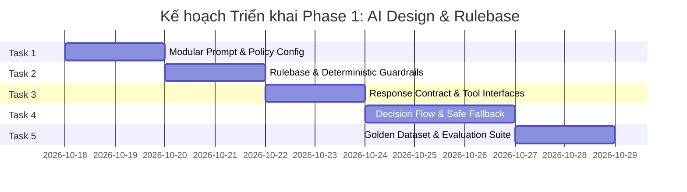

# BÁO CÁO KIỂM TOÁN KHO LƯU TRỮ VÀ KẾ HOẠCH TRIỂN KHAI PHASE 1
**Dự án**: Admission X AI — Trợ lý Tuyển sinh Đại học Điện lực (EPU)  
**Nhánh Git**: `docs/phase-1-ai-behavior-policy-v1` | **Commit**: `8155b88` | **Trạng thái**: Clean working tree  
**Vai trò**: Senior AI Engineer & Software Architect  
**Mục tiêu**: Báo cáo kiểm toán hiện trạng kỹ thuật kho lưu trữ và kế hoạch triển khai chi tiết cho Phase 1: AI Design & Rulebase (Task 1 – Task 5).

---

## 1. BỐI CẢNH VÀ QUY TẮC THỰC THI (CONTEXT & RESTRICTIONS)

- **Repository**: `https://github.com/thanh24109/admission-x-ai`
- **Target Branch**: `docs/phase-1-ai-behavior-policy-v1` (HEAD at `8155b88`)
- **Tập dữ liệu chuẩn**: 38 ngành đào tạo chính quy (`programs.jsonl`) và 38 tệp PDF chương trình đào tạo tại `data/crawled/raw/pdf/`.
- **Ranh giới Phase 1**:
  - **ĐƯỢC PHÉP**: Xây dựng bộ nạp modular prompt, mô hình hóa typed policy, thực thi rulebase xác định (RB-01 đến RB-13), phân loại nguồn tin 4 cấp (Tier 1-4), kiểm soát trạng thái phản hồi an toàn, chuẩn hóa hợp đồng trích dẫn/response/tool contracts, và bộ kiểm chuẩn Golden Dataset V1 (80 scenarios).
  - **TUYỆT ĐỐI KHÔNG**: Phân tích cú pháp/chunking PDF, migration Supabase, sinh vector embeddings/hybrid search, gọi LLM generation thực tế, dựng compiled LangGraph state machine, đa agent tự trị, hoặc tự động tạo ticket bàn giao tư vấn viên.
- **Trạng thái**: Kế hoạch lập trình và kiểm toán độc lập. Không tự ý sửa đổi logic ứng dụng hoặc commit code khi chưa có phê duyệt.

---

## 2. TÓM TẮT KIỂM TOÁN KHO LƯU TRỮ (REPOSITORY AUDIT SUMMARY)

```mermaid
graph TD
    A[Admission X AI Codebase] --> B[Đã triển khai / Implemented]
    A --> C[Một phần / Scaffold & Stubs]
    A --> D[Chưa triển khai / Missing]

    B --> B1[Docs thiết kế Phase 1 đầy đủ 14 files]
    B --> B2[80 Golden Scenarios V1 JSONL]
    B --> B3[Dataset 38 ngành EPU + 38 file PDF CTĐT]
    B --> B4[FastAPI Modular Monolith Skeleton]

    C --> C1[System prompt đơn bản 5 dòng]
    C --> C2[Guardrails cơ bản: 3 từ khóa cam kết]
    C --> C3[Sequential Node Runner giả lập LangGraph]
    C --> C4[Retriever & Citation Validator dạng stub rỗng]
    C --> C5[In-memory Handover store]

    D --> D1[Modular Prompt Loader & Policy Engine]
    D --> D2[Bộ rulebase RB-01 đến RB-13 chuẩn hóa]
    D --> D3[Response Contract V1.1 & Tool Envelopes]
    D --> D4[Evidence Decision Gate & Safe Fallback]
    D --> D5[Evals Runner khớp với 80 scenarios]
```



### 2.1. Đã hoàn thiện (Implemented)
1. **Tài liệu đặc tả Phase 1**: 14 tài liệu chi tiết tại `docs/ai/phase-1/` định nghĩa đầy đủ quy tắc ứng xử, phân cấp nguồn tin, ma trận quyết định, hợp đồng phản hồi, hợp đồng trích dẫn, kiến trúc Single-Agent + 6 Tools, chính sách trạng thái và kế hoạch đánh giá.
2. **Bộ dữ liệu gốc**: 38 ngành đại học chính quy tại `data/crawled/raw/json/programs.jsonl` và 38 file PDF chương trình đào tạo tại `data/crawled/raw/pdf/`.
3. **Bộ dữ liệu kiểm chuẩn Golden Dataset V1**: 80 kịch bản kiểm thử tại `evals/datasets/golden_admission_v1.jsonl`.
4. **Kiến trúc Monolith FastAPI**: Khung API với các router `chat.py`, `handovers.py` và `health.py`.
5. **Giao diện người dùng Chat (Frontend)**: `CandidateChatWorkspace.tsx`, các components render tin nhắn, khung nhập liệu và trích dẫn.

### 2.2. Khung giả lập / Triển khai một phần (Scaffold & Stubs)
1. **System Prompt**: File `apps/api/app/ai/prompts/system.md` chỉ có 5 dòng tĩnh, thiếu các module phân định ranh giới EPU, quy tắc bằng chứng và cú pháp trích dẫn.
2. **Guardrails**:
   - `commitment_guard.py`: Chỉ kiểm tra 3 cụm từ cứng (`"chắc chắn đỗ"`, `"100% trúng tuyển"`, `"đảm bảo trúng tuyển"`).
   - `pii.py`: Chỉ kiểm tra whitelist trường, thiếu biểu thức chính quy nhận dạng CCCD, SĐT, Email Việt Nam.
3. **Graph Orchestrator**: `builder.py` là một hàm chạy tuần tự Python đơn giản (`run_admission_graph`), chưa có cấu trúc phân nhánh an toàn theo ma trận quyết định.
4. **Graph Nodes**: Trong `nodes.py`, hàm `retrieve` trả về `context: []`, hàm `generate` sinh văn bản tĩnh, và `confidence_gate` luôn ép `handover = True` (do confidence cố định là 0.5 < 0.65).
5. **RAG & Citations**:
   - `hybrid_retriever.py`: Lớp rỗng trả về `[]`.
   - `validator.py`: Chỉ kiểm tra `len(sources) > 0`, không kiểm tra mã tài liệu, số trang hoặc nội dung trích dẫn.
6. **Agent Stubs**: Các lớp trong `apps/api/app/ai/agents/` đều rỗng, chưa có typed interface.

### 2.3. Chưa triển khai (Missing)
1. **Modular Prompt Loader**: Chưa có engine nạp và lắp ráp prompt động theo ngữ cảnh người dùng.
2. **Deterministic Rule Engine**: Chưa có bộ kiểm tra 13 quy tắc xác định RB-01 đến RB-13.
3. **Response Envelope V1.1**: Chưa có các schema `status`, `evidence_decision`, `source_mode`, `missing_aspects`.
4. **Typed Tool Contracts**: Chưa có Pydantic schemas cho 6 công cụ agent.
5. **Evaluation Runner**: Chưa có script tự động thực thi và tính toán chỉ số an toàn cho 80 kịch bản Golden Dataset.

---

## 3. PHÂN TÍCH KHOẢNG CÁCH (GAP ANALYSIS)

| Hạng mục / Khía cạnh | Quy định trong Đặc tả Phase 1 | Hiện trạng Mã nguồn thực tế | Khoảng cách & Mức độ rủi ro |
| :--- | :--- | :--- | :--- |
| **1. Cấu trúc Prompt** | 7 modules: Identity, Source Policy, Scope Boundaries, Evidence Rules, Negative Guardrails, Citation Syntax, Response Formats (`prompt-architecture.md`). | File đơn `system.md` 5 dòng tĩnh. | **Nghiêm trọng (High)**: Thiếu toàn bộ hướng dẫn nghiệp vụ và quy tắc an toàn. |
| **2. Rulebase & Guardrails** | 13 quy tắc xác định RB-01 -> RB-13 (`rulebase-v1.yaml`). | `commitment_guard.py` chỉ có 3 cụm từ; không có rulebase engine. | **Nghiêm trọng (High)**: Dễ bị vượt qua bằng từ lóng hoặc câu hỏi ngoài phạm vi. |
| **3. Hợp đồng phản hồi** | Envelope có cấu trúc với 6 trạng thái: `direct_answer`, `clarification_needed`, `partial_answer`, `safe_fallback`, `handover_suggested`, `out_of_scope_redirect`. | `ChatResponse` chỉ có: `answer`, `intent`, `confidence`, `handover`, `citations`. | **Trung bình (Medium)**: Frontend không phân biệt được phản hồi trực tiếp, làm rõ hay từ chối an toàn. |
| **4. Hợp đồng trích dẫn** | Đầy đủ `citation_id`, `evidence_id`, `document_id`, `major_code`, `page_start`, `page_end`, `quote_text`, `source_tier`, `verification_status`. | Backend có `title, source`; Frontend có `page, fileType, url`. Validator chỉ check `len > 0`. | **Nghiêm trọng (High)**: Lệch schema hoàn toàn giữa FE - BE - Spec; nguy cơ trích dẫn giả mạo. |
| **5. Luồng Handover** | RB-12: Handover chỉ được đề xuất (`handover_suggested`), không bao giờ tự động tạo ticket nếu chưa có sự đồng ý. | `confidence_gate` luôn gán `handover = True` cho 100% câu hỏi vì retriever trả về rỗng. | **Nghiêm trọng (High)**: Gây quá tải tư vấn viên và làm hỏng trải nghiệm người dùng. |
| **6. Frontend Fallback** | Không được bịa đặt dữ liệu khi backend offline; phải hiển thị lỗi kết nối. | Khối catch tại `CandidateChatWorkspace.tsx` tự bịa học phí, số ngành (25 thay vì 38), điểm chuẩn và trích dẫn giả. | **Rất nghiêm trọng (Critical - P0)**: Trực tiếp phát sinh ảo giác nghiêm trọng ngay tại client. |
| **7. Hợp đồng Công cụ Agent** | 6 tools định nghĩa chi tiết: `epu_major_search`, `epu_curriculum_lookup`, `epu_admission_policy_lookup`, `epu_general_career_advisory`, `epu_handover_recommender`, `epu_clarification_generator`. | Các class trong `apps/api/app/ai/agents/` rỗng; chưa có typed envelope. | **Trung bình (Medium)**: Cần chuẩn bị typed interfaces để sẵn sàng cho Phase 7. |
| **8. Kiểm thử & Đánh giá** | 80 kịch bản kiểm thử trong `golden_admission_v1.jsonl`. | Test cũ `test_ai_integration.py` đang assert `handover is True`. Chưa có runner nạp dataset 80 scenarios. | **Trung bình (Medium)**: Test suite cũ xung đột với chính sách mới. |

---

## 4. ĐÁNH GIÁ 8 RỦI RO TRỌNG YẾU (CRITICAL RISKS INVESTIGATION)

### Rủi ro 1: Frontend tự sinh câu trả lời tuyển sinh khi Backend mất kết nối (P0 — Nguy cấp)
- **Vị trí**: `apps/web/src/components/chat/CandidateChatWorkspace.tsx` (dòng 80–115).
- **Mô tả**: Khi API `/api/v1/chat` offline, khối catch kích hoạt fallback giả lập câu trả lời: học phí 450k-550k/tín chỉ, EPU có 25 ngành (thực tế là 38 ngành), phổ điểm chuẩn 21-24.5 và trích dẫn giả mạo Đề án 2026 trang 15-18.
- **Biện pháp xử lý**: Xóa bỏ toàn bộ nội dung tuyển sinh giả lập tại frontend. Thay thế bằng thông báo lỗi kết nối mạng an toàn kèm số điện thoại hotline tuyển sinh chính thức EPU.

### Rủi ro 2: Trích dẫn giả mạo URL, số trang PDF hoặc siêu dữ liệu văn bản (P0 — Nguy cấp)
- **Vị trí**: `apps/api/app/ai/rag/citations/validator.py` và `apps/web/src/components/chat/CandidateChatWorkspace.tsx`.
- **Mô tả**: Validator chỉ kiểm tra sự tồn tại của danh sách `sources`. Frontend tự điền `fileSize: "4.2 MB"`, `page: "Trang 15 - 18"`, `url: "/post/thong-tin-tuyen-sinh-dai-hoc-chinh-quy-nam-2025"`.
- **Biện pháp xử lý**: Xây dựng `CitationVerifier` đối soát nghiêm ngặt với 38 file PDF và 38 ngành chính thức. Mọi trích dẫn phải có `document_id` hợp lệ và `page_start >= 1`.

### Rủi ro 3: Tự động bàn giao (Automatic Handover) do thiếu ngữ cảnh truy vấn (P1 — Cao)
- **Vị trí**: `apps/api/app/ai/graph/nodes.py` (dòng 42–48).
- **Mô tả**: `confidence_gate` so sánh confidence (0.5) với ngưỡng 0.65. Khi retriever trả về rỗng, `handover = True` bị bật cho 100% người dùng.
- **Biện pháp xử lý**: Tách biệt rõ ràng giữa `safe_fallback / clarification_needed` và `handover_suggested`. Chỉ gợi ý bàn giao khi người dùng chủ động yêu cầu hoặc câu hỏi khiếu nại chuyên sâu.

### Rủi ro 4: Bất đồng bộ lược đồ trích dẫn giữa Backend và Frontend (P1 — Cao)
- **Vị trí**: `apps/api/app/schemas/chat.py` vs `apps/web/src/types/chat.ts` vs `docs/ai/phase-1/citation-contract.md`.
- **Mô tả**: Backend chỉ có `title, source`; Frontend cần `id, title, source, page, fileType, url`; Đặc tả yêu cầu `citation_id, evidence_id, document_id, major_code, page_start, page_end, quote_text, source_tier`.
- **Biện pháp xử lý**: Chuẩn hóa schema `CitationContract` ở backend, bổ sung thuộc tính tương thích ngược để frontend render trực tiếp không bị vỡ.

### Rủi ro 5: Bộ lọc cam kết và quyền riêng tư quá đơn giản (P1 — Cao)
- **Vị trí**: `apps/api/app/ai/guardrails/commitment_guard.py` và `pii.py`.
- **Mô tả**: `commitment_guard` chỉ kiểm tra 3 cụm từ cứng, bỏ lọt các từ "bao đậu", "chắc suất", "yên tâm đỗ". `pii.py` chưa phát hiện và che giấu CCCD, SĐT, Email.
- **Biện pháp xử lý**: Bổ sung regex mở rộng bao phủ từ lóng tuyển sinh và xây dựng hàm che giấu (`mask_pii`) nhận dạng CCCD 12 số, SĐT 10 số.

### Rủi ro 6: Tính tương thích ngược với API Chat Client hiện có (P2 — Trung bình)
- **Vị trí**: `apps/api/app/api/routes/chat.py` và `apps/api/app/schemas/chat.py`.
- **Mô tả**: Nâng cấp Response Envelope có nguy cơ làm gãy cấu trúc JSON mà client frontend đang bóc tách.
- **Biện pháp xử lý**: Áp dụng mô hình mở rộng không phá vỡ (Non-breaking additive expansion), duy trì các trường legacy ở tầng gốc.

### Rủi ro 7: Các bài kiểm thử hiện có đang khẳng định hành vi lỗi cũ (P2 — Trung bình)
- **Vị trí**: `apps/api/tests/test_ai_integration.py` (dòng 26) và `evals/harness/tests/test_handover.py` (dòng 9–10).
- **Mô tả**: Test cũ đang assert `assert result["handover"] is True` khi hỏi thông tin tuyển sinh.
- **Biện pháp xử lý**: Tái cấu trúc assertion của các test này trong Task 4 & Task 5, khẳng định `status == "safe_fallback"` và `handover == False`.

### Rủi ro 8: Xung đột giữa tài liệu chính sách mới và logic điều phối hiện tại (P1 — Cao)
- **Vị trí**: `apps/api/app/ai/graph/nodes.py` và `docs/ai/phase-1/decision-matrix.md`.
- **Mô tả**: Logic hiện tại phân loại intent bằng từ khóa cứng và thiếu hẳn khái niệm đánh giá bằng chứng theo ma trận 10 điều kiện.
- **Biện pháp xử lý**: Xây dựng module `DecisionMatrixEngine` chuyên trách xử lý logic theo đúng tài liệu thiết kế.

---

## 5. KẾ HOẠCH TRIỂN KHAI CHI TIẾT (TASKS 1 – 5 IMPLEMENTATION PLAN)



### Task 1: Modular System Prompt & Policy Configuration
- **Mục tiêu**: Xây dựng cơ chế nạp prompt module hóa (7 modules) và Pydantic configuration cho `rulebase-v1.yaml`.
- **Tệp tái sử dụng**: `apps/api/app/ai/prompts/system.md`, `docs/ai/phase-1/rulebase-v1.yaml`.
- **Tệp tạo mới / sửa đổi**:
  - *Tạo mới*: `apps/api/app/ai/prompts/modules/01_identity.md` đến `07_response_formats.md`, `apps/api/app/ai/prompts/builder.py`, `apps/api/app/ai/config/policy_config.py`.
  - *Sửa đổi*: `apps/api/app/ai/prompts/system.md`.
- **Dependencies**: `pydantic >= 2.0`, `pyyaml >= 6.0`.
- **Các bước thực hiện**:
  1. Trích xuất 7 module markdown theo đúng `prompt-architecture.md`.
  2. Định nghĩa Typed Pydantic Models nạp và kiểm tra tính hợp lệ của `rulebase-v1.yaml`.
  3. Cài đặt `SystemPromptBuilder` hỗ trợ ghép nối module và inject tham số động (năm tuyển sinh, tổng số 38 ngành).
- **Tests cần lập**: `apps/api/tests/ai/test_prompt_builder.py` (kiểm tra nạp đủ module, format Unicode, không thiếu biến).
- **Tiêu chí nghiệm thu**: Nạp `rulebase-v1.yaml` thành công 100% type-safe; sinh prompt hoàn chỉnh đạt chuẩn đặc tả.
- **Độ phức tạp**: Thấp (1.5 ngày).

### Task 2: Rulebase & Deterministic Guardrails
- **Mục tiêu**: Hiện thực hóa bộ đánh giá quy tắc xác định RB-01 đến RB-13, nâng cấp regex cam kết trúng tuyển và che giấu PII.
- **Tệp tái sử dụng**: `apps/api/app/ai/guardrails/commitment_guard.py`, `pii.py`.
- **Tệp tạo mới / sửa đổi**:
  - *Tạo mới*: `apps/api/app/ai/rules/engine.py`, `apps/api/app/ai/rules/models.py`, `apps/api/app/ai/guardrails/scope_guard.py`.
  - *Sửa đổi*: `apps/api/app/ai/guardrails/commitment_guard.py`, `apps/api/app/ai/guardrails/pii.py`.
- **Dependencies**: Thư viện chuẩn `re`, `typing`, `pydantic`.
- **Các bước thực hiện**:
  1. Xây dựng `RulebaseEngine` phân tách kiểm tra Pre-generation (Input) và Post-generation (Output).
  2. Nâng cấp `commitment_guard` với regex engine bắt toàn bộ từ lóng cam kết đỗ.
  3. Bổ sung `mask_pii` trong `pii.py` che giấu CCCD 12 số, SĐT 10 số.
  4. Tạo `ScopeGuard` xác định câu hỏi EPU, hướng nghiệp chung hay ngoài phạm vi.
- **Tests cần lập**: `test_commitment_guard.py` (15 ca cam kết đỗ), `test_pii_guard.py` (mask PII), `test_rulebase_engine.py` (từng quy tắc RB-01 -> RB-13).
- **Tiêu chí nghiệm thu**: Phát hiện 100% vi phạm cam kết đỗ; không false-positive trên câu hỏi hợp lệ.
- **Độ phức tạp**: Trung bình (2 ngày).

### Task 3: Response Contract & Agent Tool Interfaces
- **Mục tiêu**: Chuẩn hóa Response Envelope V1.1, Citation Contract và Typed Tool Interfaces cho 6 tools.
- **Tệp tái sử dụng**: `apps/api/app/schemas/chat.py`, `validator.py`.
- **Tệp tạo mới / sửa đổi**:
  - *Tạo mới*: `apps/api/app/schemas/citation.py`, `apps/api/app/schemas/response_envelope.py`, `apps/api/app/ai/tools/contracts.py`, `apps/api/app/ai/rag/citations/verifier.py`.
  - *Sửa đổi*: `apps/api/app/schemas/chat.py`, `apps/api/app/ai/rag/citations/validator.py`.
- **Dependencies**: `pydantic >= 2.0`.
- **Các bước thực hiện**:
  1. Định nghĩa `CitationContract` đầy đủ metadata, kèm alias tương thích giao diện frontend.
  2. Định nghĩa `AdmissionResponseEnvelope` với 6 trạng thái phản hồi.
  3. Định nghĩa schema I/O cho 6 công cụ agent trong `contracts.py`.
  4. Cài đặt `CitationVerifier` đối soát trích dẫn với danh mục 38 ngành và 38 file PDF.
- **Tests cần lập**: `test_response_envelope.py`, `test_citation_contract.py`, `test_tool_contracts.py`.
- **Tiêu chí nghiệm thu**: Endpoint `/api/v1/chat` tuân thủ 100% Response Envelope V1.1; 100% citation được xác thực tồn tại trong kho dữ liệu.
- **Độ phức tạp**: Trung bình (2 ngày).

### Task 4: Decision Flow & Safe Fallback
- **Mục tiêu**: Hiện thực hóa Ma trận quyết định 10 điều kiện, sửa dứt điểm lỗi tự động bật handover 100%, định tuyến qua Safe Fallback khi thiếu bằng chứng.
- **Tệp tái sử dụng**: `apps/api/app/ai/graph/builder.py`, `nodes.py`, `state.py`.
- **Tệp tạo mới / sửa đổi**:
  - *Tạo mới*: `apps/api/app/ai/decision/matrix.py`, `apps/api/app/ai/decision/fallbacks.py`.
  - *Sửa đổi*: `apps/api/app/ai/graph/state.py`, `apps/api/app/ai/graph/nodes.py`, `apps/api/app/ai/graph/builder.py`, `apps/api/app/api/routes/chat.py`.
- **Dependencies**: `pydantic`, `typing`.
- **Các bước thực hiện**:
  1. Cài đặt `DecisionMatrixEngine` xử lý 10 kịch bản bằng chứng (EPU Official, Mixed, Out-of-Scope, Future, Insufficient, ...).
  2. Tạo bộ mẫu phản hồi an toàn chuẩn (`fallbacks.py`) lịch thiệp, không bịa đặt số liệu.
  3. Sửa node `confidence_gate` trong `nodes.py`: chuyển sang `safe_fallback` thay vì ép `handover = True`.
  4. Cập nhật luồng tuần tự trong `builder.py` tích hợp `DecisionMatrixEngine`.
- **Tests cần lập**: `test_decision_matrix.py` (10 điều kiện), `test_safe_fallback_flow.py` (thiếu dữ liệu không kích hoạt handover), cập nhật `test_ai_integration.py`.
- **Tiêu chí nghiệm thu**: 0% tự động handover khi thiếu ngữ cảnh; trạng thái phản hồi khớp 1-1 với ma trận quyết định.
- **Độ phức tạp**: Cao (2.5 ngày).

### Task 5: Golden Dataset & Tests
- **Mục tiêu**: Tích hợp chạy kiểm chuẩn tự động 80 kịch bản trong `golden_admission_v1.jsonl`, tính toán chỉ số an toàn và xuất báo cáo.
- **Tệp tái sử dụng**: `evals/datasets/golden_admission_v1.jsonl`, `evals/harness/`.
- **Tệp tạo mới / sửa đổi**:
  - *Tạo mới*: `evals/harness/runner.py`, `evals/metrics/compliance_metrics.py`, `apps/api/tests/evals/test_golden_dataset_v1.py`.
  - *Sửa đổi*: `evals/harness/tests/test_handover.py`.
- **Dependencies**: `pytest`, `pydantic`.
- **Các bước thực hiện**:
  1. Viết parser nạp 80 kịch bản JSONL.
  2. Xây dựng runner so sánh kết quả thực thi với `expected_status`, `forbidden_phrases`, `required_phrases`.
  3. Xuất báo cáo định lượng kiểm chuẩn tại `evals/reports/phase1_compliance_report.json`.
- **Tests cần lập**: `pytest evals/harness/` và `pytest apps/api/tests/`.
- **Tiêu chí nghiệm thu**: 80/80 kịch bản chạy thành công; Tỷ lệ cam kết đỗ = 0%; Tỷ lệ Safe Fallback khi thiếu dữ liệu = 100%.
- **Độ phức tạp**: Trung bình (2 ngày).

---

## 6. MA TRẬN THAY ĐỔI TỆP (FILE CHANGE MATRIX)

| Tệp (File Path) | Hành động | Thuộc Task | Mục đích kỹ thuật |
| :--- | :---: | :---: | :--- |
| `apps/api/app/ai/prompts/modules/01_identity.md`..`07_response_formats.md` | Tạo mới | Task 1 | 7 modules prompt chuẩn hóa. |
| `apps/api/app/ai/prompts/builder.py` | Tạo mới | Task 1 | Class lắp ráp prompt động. |
| `apps/api/app/ai/config/policy_config.py` | Tạo mới | Task 1 | Pydantic model cho `rulebase-v1.yaml`. |
| `apps/api/app/ai/prompts/system.md` | Sửa đổi | Task 1 | Cập nhật template prompt cốt lõi. |
| `apps/api/app/ai/rules/engine.py` | Tạo mới | Task 2 | Engine kiểm tra quy tắc RB-01 đến RB-13. |
| `apps/api/app/ai/rules/models.py` | Tạo mới | Task 2 | Typed models biểu diễn kết quả vi phạm. |
| `apps/api/app/ai/guardrails/commitment_guard.py` | Sửa đổi | Task 2 | Mở rộng regex chống cam kết đỗ. |
| `apps/api/app/ai/guardrails/pii.py` | Sửa đổi | Task 2 | Bổ sung hàm che giấu CCCD, SĐT, Email. |
| `apps/api/app/ai/guardrails/scope_guard.py` | Tạo mới | Task 2 | Phân loại phạm vi câu hỏi tuyển sinh. |
| `apps/api/app/schemas/citation.py` | Tạo mới | Task 3 | Schema chuẩn cho `CitationContract`. |
| `apps/api/app/schemas/response_envelope.py` | Tạo mới | Task 3 | Schema chuẩn cho `AdmissionResponseEnvelope`. |
| `apps/api/app/schemas/chat.py` | Sửa đổi | Task 3 | Mở rộng không phá vỡ `ChatResponse`. |
| `apps/api/app/ai/tools/contracts.py` | Tạo mới | Task 3 | Typed interfaces cho 6 agent tools. |
| `apps/api/app/ai/rag/citations/verifier.py` | Tạo mới | Task 3 | Đối soát trích dẫn với catalog 38 ngành/PDF. |
| `apps/api/app/ai/rag/citations/validator.py` | Sửa đổi | Task 3 | Kết nối validator vào verifier chuẩn. |
| `apps/api/app/ai/decision/matrix.py` | Tạo mới | Task 4 | Engine ma trận quyết định 10 kịch bản. |
| `apps/api/app/ai/decision/fallbacks.py` | Tạo mới | Task 4 | Các mẫu câu phản hồi an toàn chuẩn mực. |
| `apps/api/app/ai/graph/state.py` | Sửa đổi | Task 4 | Thêm các trường trạng thái vào `AdmissionState`. |
| `apps/api/app/ai/graph/nodes.py` | Sửa đổi | Task 4 | Bỏ gán cứng `handover = True`, thêm safe fallback. |
| `apps/api/app/ai/graph/builder.py` | Sửa đổi | Task 4 | Điều phối tuần tự tích hợp Decision Engine. |
| `apps/api/app/api/routes/chat.py` | Sửa đổi | Task 4 | Trả về payload Envelope V1.1. |
| `apps/api/tests/test_ai_integration.py` | Sửa đổi | Task 4/5 | Cập nhật assertions không ép handover. |
| `evals/harness/runner.py` | Tạo mới | Task 5 | Runner chạy tự động 80 scenarios. |
| `evals/metrics/compliance_metrics.py` | Tạo mới | Task 5 | Module tính toán các chỉ số an toàn. |
| `apps/api/tests/evals/test_golden_dataset_v1.py` | Tạo mới | Task 5 | Pytest suite cho Golden Dataset V1. |

---

## 7. THỨ TỰ PHỤ THUỘC VÀ THỰC THI (DEPENDENCY & EXECUTION ORDER)

```
[Task 1: Modular System Prompt & Policy Config]
       │
       ▼ (Cung cấp định nghĩa quy tắc & policy models)
[Task 2: Rulebase & Deterministic Guardrails]
       │
       ▼ (Cung cấp bộ lọc an toàn & mã vi phạm)
[Task 3: Response Contract & Agent Tool Interfaces]
       │
       ▼ (Cung cấp cấu trúc dữ liệu phản hồi & tiêu chuẩn trích dẫn)
[Task 4: Decision Flow & Safe Fallback]
       │
       ▼ (Hoàn thiện toàn bộ pipeline điều phối an toàn)
[Task 5: Golden Dataset & Evaluation Suite]
```

---

## 8. TIÊU CHÍ HOÀN THÀNH PHASE 1 (DEFINITION OF DONE)

1. **Rulebase Compliance**: 13 quy tắc RB-01 đến RB-13 được mô hình hóa bằng code và có unit test tương ứng. Tỷ lệ cam kết đỗ trái phép = 0%.
2. **Zero Hallucination**: Mọi thông tin EPU xuất ra đều gắn với `document_id` trong danh mục 38 ngành/38 PDF. Thiếu dữ liệu bắt buộc kích hoạt `safe_fallback`.
3. **Handover Correctness**: 0% tự động kích hoạt bàn giao khi người dùng hỏi thông tin thông thường. Bàn giao chỉ gợi ý khi có sự đồng thuận.
4. **Contract Conformity**: `/api/v1/chat` trả về đúng 100% `AdmissionResponseEnvelope` V1.1, tương thích ngược với frontend hiện tại.
5. **Evaluation Pass Rate**: Thực thi thành công toàn bộ 80 kịch bản trong `golden_admission_v1.jsonl`, độ chính xác phân loại >= 95%.
6. **Strict Scope Preservation**: Không tích hợp LangGraph phức tạp, vector DB, LLM sinh văn bản bên ngoài hoặc thay đổi DB Supabase trong Phase 1.

---

## 9. CÁC QUYẾT ĐỊNH MỞ CẦN PHÊ DUYỆT (OPEN QUESTIONS)

1. **Xử lý khối Fallback tạo ảo giác ở Frontend (`CandidateChatWorkspace.tsx`)**: Đề xuất xóa bỏ dữ liệu học phí/ngành/điểm chuẩn giả lập trong khối `catch` của frontend, chỉ hiển thị thông báo mất kết nối an toàn.
2. **Cơ chế phục vụ file PDF chương trình đào tạo cho Citation URL**: Trong Citation Contract, trường `url` trích dẫn PDF nên tạm thời trỏ về route tĩnh `/api/v1/documents/pdf/{filename}` của FastAPI hay giữ link nguồn gốc từ cổng EPU?
3. **Cập nhật Assertion của các Unit Test cũ**: Đồng thuận cập nhật lại các assertion trong `test_ai_integration.py` (chuyển từ `handover is True` sang `status == "safe_fallback"` và `handover is False`) khi triển khai Task 4.
