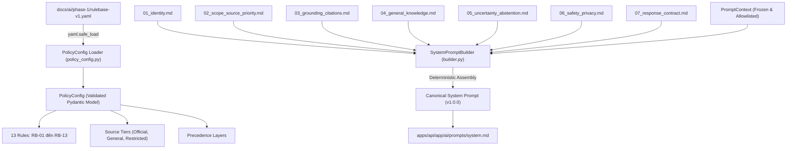

# BÁO CÁO KẾT QUẢ THỰC HIỆN TASK 1: MODULAR SYSTEM PROMPT & POLICY CONFIGURATION

**Dự án**: Admission X AI — Trợ lý Tuyển sinh Đại học Điện lực (EPU)  
**Nhánh Git**: `feat/phase-1-task-1-prompt-policy`  
**Commit**: `d2a0233` (`feat(ai): implement modular prompt builder and typed policy config`)  
**Trạng thái**: Clean working tree — 100% tests & linter passed.

---

## A. TỔNG KẾT TRIỂN KHAI (IMPLEMENTATION SUMMARY)

Trong khuôn khổ Task 1 của Phase 1, hai nền tảng cốt lõi đã được xây dựng và hoàn thiện theo tiêu chuẩn production-ready:

### 1. Modular System Prompt Builder (`SystemPromptBuilder`)
- **Cấu trúc 7 Modules**: Phân tách system prompt thành 7 module Markdown độc lập, sắp xếp theo thứ tự xác định theo đúng đặc tả `docs/ai/phase-1/prompt-architecture.md`.
- **Danh tính công khai chuẩn mực**:
  - Trợ lý chính thức đại diện cho **"Cổng thông tin tuyển sinh"**, **"Trường Đại học Điện lực"** (EPU).
  - Ngôn ngữ mặc định: **Tiếng Việt**.
  - Tuyệt đối bảo mật mã dự án kỹ thuật nội bộ ("Admission X AI"), không xuất hiện trong các câu xưng hô trước thí sinh và phụ huynh.
- **Tính toán vẹn & Xác định (Deterministic Composition)**:
  - Sinh prompt theo chuỗi cố định không thay đổi qua các lần gọi lặp lại.
  - Bảo toàn 100% tiếng Việt có dấu và các thuật ngữ chuyên ngành tuyển sinh.
  - Tích hợp nhãn phiên bản prompt (`PROMPT_VERSION = "1.0.0"`).
- **Mô hình Ngữ cảnh an toàn (`PromptContext`)**:
  - Sử dụng Pydantic Model với `frozen=True` (bất biến).
  - Chỉ cho phép các trường allowlisted: `admissions_year`, `default_language`, `institution_name`, `portal_name`, `extra_allowed_metadata`.
  - Kiểm tra và từ chối các ký tự điều khiển/xuống dòng (`\r`, `\n`) nhằm ngăn chặn triệt để nguy cơ Prompt Injection từ dữ liệu không tin cậy.

### 2. Typed Policy Configuration (`PolicyConfig`)
- **Kiểm định nghiêm ngặt bằng Pydantic v2**: Nạp và kiểm tra tính hợp lệ toàn diện của `docs/ai/phase-1/rulebase-v1.yaml`.
- **Bảo toàn 13 Quy tắc xác định**:
  - Kiểm định sự tồn tại đầy đủ và duy nhất của 13 quy tắc từ `RB-01` đến `RB-13`.
  - Phân loại rõ ràng các mức độ ưu tiên (`RulePriority`: `critical`, `high`, `medium`, `low`).
  - Kiểm tra các tầng thực thi (`enforcement_layer`), các kịch bản kiểm thử (`test_cases`) và phân cấp 3 tầng nguồn tin (`SourceTiers`: `official_epu`, `general`, `restricted`).
- **Độc lập môi trường làm việc (CWD-Independent)**:
  - Hàm `find_default_rulebase_path()` hỗ trợ biến môi trường `RULEBASE_CONFIG_PATH` và tự động tìm ngược cây thư mục về gốc dự án.
  - Sử dụng `yaml.safe_load`, không thực thi mã độc hại.
- **Tách biệt ranh giới**: Task 1 chỉ phụ trách nạp và kiểm định cấu hình; không nhúng logic thực thi engine (thuộc về Task 2).

---

## B. DANH MỤC CÁC TỆP THAY ĐỔI (CHANGED FILES)

### 1. Tệp tạo mới (New Files)
- **Các phân đoạn Prompt Modules** (tại `apps/api/app/ai/prompts/modules/`):
  - `01_identity.md`: Vai trò, danh tính công khai EPU, ngôn ngữ mặc định Tiếng Việt, văn phong sư phạm.
  - `02_scope_source_priority.md`: Phân cấp 3 tầng dữ liệu (Tier 1, Tier 2, Tier 3), thứ bậc ưu tiên và cô lập dữ liệu.
  - `03_grounding_citations.md`: Nguyên tắc căn cứ bằng chứng, cấm bịa nguồn/trang/PDF, giới hạn thẩm quyền của 38 PDF CTĐT.
  - `04_general_knowledge.md`: Chính sách kiến thức chung & hướng nghiệp phổ quát, quy tắc phân tách câu trả lời hỗn hợp (mixed answers).
  - `05_uncertainty_abstention.md`: Xử lý thiếu dữ liệu, từ chối an toàn, trả lời từng phần, chủ động làm rõ, không tự động tạo ticket bàn giao.
  - `06_safety_privacy.md`: Tuyệt đối cấm cam kết đỗ/việc làm, bảo vệ dữ liệu cá nhân, phòng thủ prompt injection.
  - `07_response_contract.md`: Hợp đồng phản hồi, phong cách chuẩn mực, cấu trúc rõ ràng.
- **Mã nguồn Logic Core**:
  - `apps/api/app/ai/prompts/builder.py`: Lớp `SystemPromptBuilder`, `PromptContext`, các ngoại lệ `PromptModuleNotFoundError`, `PromptModuleEmptyError` và các hàm tiện ích `build_system_prompt()`, `get_system_prompt_version()`.
  - `apps/api/app/ai/config/policy_config.py`: Các Pydantic models `PolicyConfig`, `RuleDefinition`, `RulePriority`, `SourceTiers`, bộ nạp an toàn `load_policy_config()`.
  - `apps/api/app/ai/config/__init__.py`: Export công khai các thành phần cấu hình chính sách.
- **Unit Tests**:
  - `apps/api/tests/test_prompt_builder.py`: 9 unit tests bao phủ toàn bộ chức năng của builder.
  - `apps/api/tests/test_policy_config.py`: 10 unit tests bao phủ việc nạp, kiểm định schema và các kịch bản negative tests.

### 2. Tệp sửa đổi (Modified Files)
- `apps/api/app/ai/prompts/__init__.py`: Xuất các class và hàm công khai (`build_system_prompt`, `SystemPromptBuilder`, `PromptContext`, ...).
- `apps/api/app/ai/prompts/system.md`: Cập nhật nội dung đồng bộ với kết quả lắp ráp hoàn chỉnh của `build_system_prompt()`, giữ vai trò tệp chuẩn mực tương thích ngược.
- `apps/api/pyproject.toml`: Đăng ký `ai/prompts/modules/*.md` vào package-data và cấu hình `--basetemp=.pytest_tmp` an toàn trong môi trường sandbox Windows.

---

## C. KIẾN TRÚC KỸ THUẬT (ARCHITECTURE)



### 1. Cơ chế hoạt động của Prompt Builder
- **Thứ tự xác định (Deterministic Ordering)**: `REQUIRED_MODULES` quy định thứ tự bất biến từ `01_identity.md` đến `07_response_contract.md`. Việc build prompt nhiều lần trên cùng cấu hình luôn sinh ra cùng một chuỗi ký tự đồng nhất (`prompt1 == prompt2`).
- **Xác thực toàn vẹn tệp**: Kiểm tra sự tồn tại của từng tệp module; nếu thiếu tệp ném lỗi `PromptModuleNotFoundError`, nếu tệp rỗng hoặc chỉ có khoảng trắng ném lỗi `PromptModuleEmptyError`.
- **Ngăn chặn Prompt Injection**: `PromptContext` được cấu hình `frozen=True` với các trường allowlisted chặt chẽ (`admissions_year`, `default_language`, `institution_name`, `portal_name`). Từ chối các chuỗi chứa ký tự xuống dòng (`\r`, `\n`) hoặc vượt độ dài an toàn trong metadata.

### 2. Cơ chế hoạt động của Policy Configuration
- **Mô hình hóa dữ liệu (Typed Models)**: Định nghĩa `RuleDefinition` bằng Pydantic, bắt buộc mã quy tắc khớp regex `^RB-\d{2}$`.
- **Kiểm định toàn vẹn (Integrity Validation)**: Validator tự động kiểm tra số lượng quy tắc (phải đúng 13 quy tắc), kiểm tra tính duy nhất (từ chối nếu trùng ID), và đối soát tập ID phải chính xác là `{'RB-01', ..., 'RB-13'}`.
- **Độc lập môi trường thực thi**: Hàm `find_default_rulebase_path()` hỗ trợ biến môi trường `RULEBASE_CONFIG_PATH` và tự động duyệt ngược từ vị trí module để tìm đường dẫn `docs/ai/phase-1/rulebase-v1.yaml`, cho phép code chạy đúng bất kể CWD ở thư mục gốc repo hay trong `apps/api`.

---

## D. KẾT QUẢ KIỂM THỬ VÀ KIỂM TRA CHẤT LƯỢNG (TEST RESULTS)

### 1. Kiểm thử Tự động (Pytest)
Lệnh thực thi:
```bash
& "E:\admission-x-ai\.venv\Scripts\python.exe" -m pytest apps/api/tests evals/harness/tests
```
**Kết quả**:
```text
============================= test session starts =============================
platform win32 -- Python 3.13.5, pytest-8.4.2, pluggy-1.6.0
rootdir: E:\admission-x-ai
configfile: pyproject.toml
plugins: anyio-4.15.1, langsmith-0.14.7, agentharness-0.1.0a2
collected 32 items

apps\api\tests\test_ai_integration.py ...                                [  9%]
apps\api\tests\test_chat.py .                                            [ 12%]
apps\api\tests\test_database.py .....                                    [ 28%]
apps\api\tests\test_health.py .                                          [ 31%]
apps\api\tests\test_policy_config.py ..........                          [ 62%]
apps\api\tests\test_prompt_builder.py .........                          [ 90%]
evals\harness\tests\test_guardrail.py .                                  [ 93%]
evals\harness\tests\test_handover.py .                                   [ 96%]
evals\harness\tests\test_trace_behavior.py .                             [100%]

Agent-Harness: 7 passed, 0 failed
============================= 32 passed in 6.59s ==============================
```
- **Tổng số tests**: **32 passed, 0 failed, 0 errors**.
- **`test_prompt_builder.py`**: 9/9 passed (nạp đủ 7 module, thứ tự xác định, Unicode tiếng Việt, bắt lỗi tệp thiếu/rỗng, truy xuất version, bảo vệ context chống injection, phân tách kiến thức chung vs chính thức).
- **`test_policy_config.py`**: 10/10 passed (nạp đủ 13 rules, kiểm tra tính duy nhất, helper functions, nạp từ explicit path & CWD khác, bắt lỗi file missing, bắt lỗi cú pháp YAML, bắt lỗi root non-dict, bắt lỗi trùng ID, bắt lỗi thiếu trường, bắt lỗi sai priority).
- **Existing tests**: 13/13 passed (giữ nguyên tính tương thích của API và database tests).

### 2. Kiểm tra Định dạng & Quy chuẩn (Ruff Linter)
Lệnh thực thi:
```bash
& "E:\admission-x-ai\.venv\Scripts\python.exe" -m ruff check apps/api
```
**Kết quả**:
```text
All checks passed!
```

---

## E. TÍNH TƯƠNG THÍCH (COMPATIBILITY)

1. **Tương thích ngược (Backward Compatibility)**:
   - File `apps/api/app/ai/prompts/system.md` tiếp tục tồn tại ở vị trí cũ nhưng nay chứa đầy đủ nội dung của prompt phiên bản 1.0.0, giúp bất kỳ công cụ hoặc thành phần nào đọc file này trực tiếp vẫn nhận được văn bản chuẩn mực.
   - Hàm `build_system_prompt()` trong `apps/api/app/ai/prompts/__init__.py` cung cấp interface chuẩn cho các giai đoạn tiếp theo.
2. **Không làm thay đổi hành vi API hiện tại**:
   - Endpoint `/api/v1/chat` và router FastAPI không bị ảnh hưởng tiêu cực trong Task 1, đảm bảo client frontend không phát sinh lỗi bất ngờ.
3. **Tuân thủ quy tắc workspace**:
   - Không cài thêm dependencies ngoại lai; tái sử dụng hoàn toàn `pydantic` và `pyyaml` đã có trong môi trường ảo dự án.
   - Không can thiệp vào mã nguồn Phase 2–10 (chưa đụng tới LangGraph compile, vector embeddings hay DB migrations).

---

## F. TRẠNG THÁI PHIÊN BẢN GIT (GIT STATUS)

- **Nhánh**: `feat/phase-1-task-1-prompt-policy` (nhánh tính năng riêng biệt, không commit trực tiếp vào `main`).
- **Commit SHA**: `d2a02336c00341fcb0a411318680e1d3bcdaa71f`
- **Thông điệp Commit**: `feat(ai): implement modular prompt builder and typed policy config`
- **Trạng thái Working Tree**: Hoàn toàn sạch (`nothing to commit, working tree clean`).

---

## G. CHUẨN BỊ CHO TASK 2 (TASK 2 PREPARATION)

Task 1 đã hoàn thành và cung cấp đầy đủ 2 thành phần nền tảng:
1. `apps/api/app/ai/config/policy_config.py` sẵn sàng để `RulebaseEngine` của Task 2 import và sử dụng trực tiếp để thực thi kiểm định quy tắc.
2. `SystemPromptBuilder` sẵn sàng để gắn nhãn các vi phạm quy tắc an toàn.

**Nội dung dự kiến của Task 2: Rulebase & Deterministic Guardrails**:
- Xây dựng `apps/api/app/ai/rules/engine.py` và `apps/api/app/ai/rules/models.py`.
- Nâng cấp `commitment_guard.py` với regex engine toàn diện bắt các từ lóng cam kết trúng tuyển ("bao đậu", "chắc suất", "yên tâm đỗ", "cam kết trúng tuyển", ...).
- Nâng cấp `pii.py` với hàm `mask_pii()` phát hiện và che giấu CCCD 12 số, SĐT 10 số và Email.
- Xây dựng bộ test suite kiểm tra chi tiết cả 13 quy tắc RB-01 đến RB-13.
